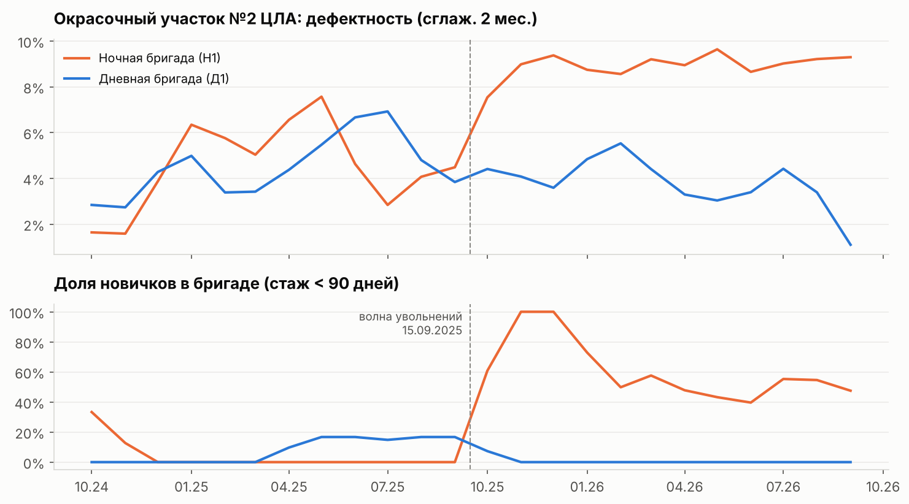
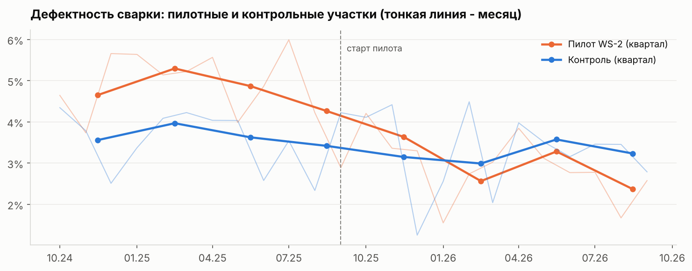
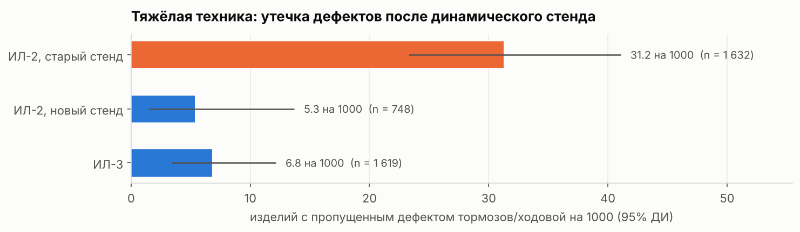
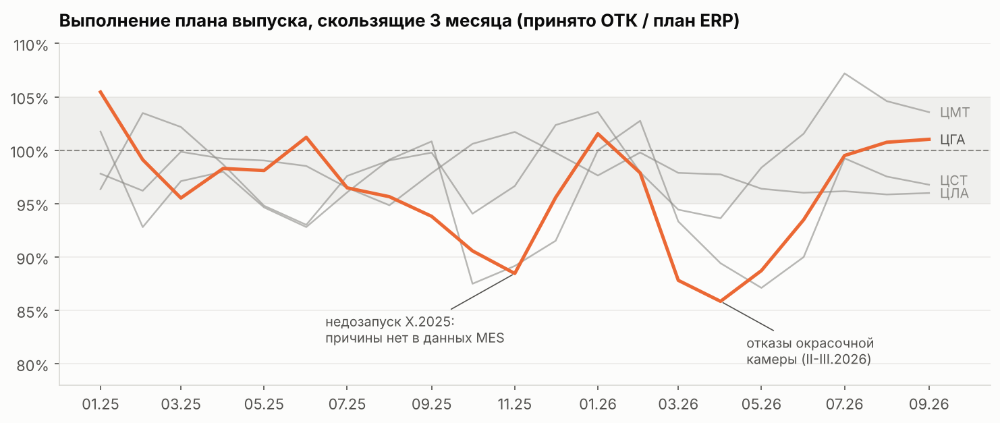
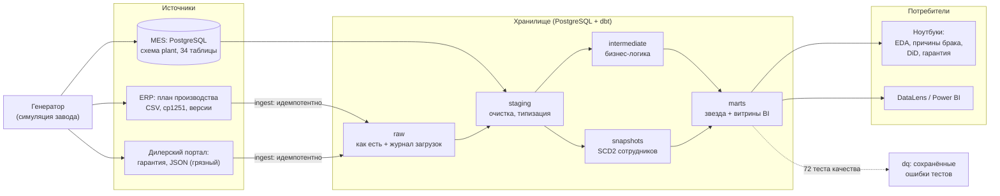

# Аналитика производства и качества автозавода


Сквозной проект «от операционной базы до управленческого решения»: информационная система завода (PostgreSQL), пайплайн и хранилище данных (Python + dbt), анализ первопричин брака, оценка пилотного изменения методом разности разностей, гарантийная аналитика и дашборды для DataLens и Power BI.

Вырос из учебной практики по базам данных (МГТУ им. Н.Э. Баумана): исходная схема была переработана, а поверх неё построена полноценная аналитическая платформа.

> **Данные синтетические**, но не случайные: генератор моделирует работу завода за 24 месяца (22 тыс. машин, 113 тыс. операций, 93 тыс. испытаний) и закладывает в данные реальные производственные закономерности. Поскольку «правильные ответы» известны, проект проверяет, что методы анализа их действительно находят - [подробнее](docs/06_synthetic_data.md).

---

## Ключевые выводы

| # | Находка | Цифры | Решение |
|---|---|---|---|
| 1 | Рост брака на окраске ЦЛА - следствие **текучести кадров в одной ночной бригаде** | дефектность 4.7% → 9.0%; 26 человек через бригаду из 6 за год; +10 п.п. новичков = +11% к шансам дефекта по всему заводу | наставничество, лимит 30% новичков на критичных операциях, разбор причин ухода с HR |
| 2 | Новый стандарт сварки WS-2 **работает, но в текущем виде не окупается** | −36% к шансам дефекта (DiD, 95% ДИ −14…−53%), +4% ко времени сварки; выгода 0.24 млн ₽/год против 0.85 млн ₽ затрат | не тиражировать как есть; упростить до ≤1.1% доп. времени или уточнить полную стоимость дефекта (порог - 10.6 тыс. ₽) |
| 3 | Старый тормозной стенд ИЛ-2 **пропускал дефекты** тормозов и ходовой | утечка 31 на 1000 изделий против 5-7 на остальных стендах (×4.9, p < 10⁻⁸); ~2.5 млн ₽ лишних гарантийных выплат | мониторинг «утечки» по каждому стенду как ранний индикатор - вынесен на дашборд |
| 4 | **«Штурмовщина»** в конце месяца | в последние 3 рабочих дня запусков на 40% больше, дефектность в 1.42 раза выше | выравнивание суточного графика запусков |
| 5 | Срыв плана ЦГА весной 2026 - **отказы окрасочной камеры** (узкое место без резерва) | 141 ч внеплановых простоев за 2 месяца; −58 машин к плану, 0.76 млрд ₽ выручки сдвинуто | резерв/ППР окрасочной камеры; осенний недозапуск 2025 причиной в MES не объясняется - вопрос к ПДО |
| 6 | Наивная гарантийная метрика **показывает ложное улучшение** | доля машин с заявкой «падает» у свежих партий из-за цензурирования; по Каплану-Мейеру уровень стабилен | гарантия на дашборде - когортами с фиксированным горизонтом |

Полный отчёт для руководства: [reports/analytical_report.md](reports/analytical_report.md).

<p align="center">
  
  
</p>
<p align="center">
  
  
</p>

---

## Архитектура



Подробно: [docs/05_data_platform.md](docs/05_data_platform.md).

## Что демонстрирует проект

| Роль | Что сделано | Где смотреть |
|---|---|---|
| **Data Engineer** | Нормализованная OLTP-схема с декларативной целостностью (составные FK, exclusion-ограничения на периоды); идемпотентная загрузка внешних файлов; dbt: staging → intermediate → marts, инкрементальные модели с обработкой поздно приходящих фактов, SCD2-снапшот, 72 теста качества; оркестрация (CLI, Airflow DAG), CI на GitHub Actions, Docker | [sql/oltp](sql/oltp), [pipeline](pipeline), [dwh](dwh), [docs/05](docs/05_data_platform.md) |
| **Data Analyst** | SQL: оконные функции, CTE, ROLLUP, gaps-and-islands, перцентили, PIVOT, LATERAL; EDA, план-факт, сезонность, Парето дефектов, логистическая регрессия факторов брака | [sql/analysis](sql/analysis), [01](notebooks/01_overview.ipynb), [02](notebooks/02_quality_root_cause.ipynb) |
| **Product Analyst** | Оценка эффекта изменения без рандомизации: разность разностей, two-way FE, кластеризованные ошибки, рандомизационный тест, event study; воронка «линия → испытания → гарантия», когорты и кривые дожития (Каплан-Мейер), кривая обучения | [03](notebooks/03_ws2_pilot_did.ipynb), [04](notebooks/04_warranty_and_labs.ipynb) |
| **Business Analyst** | Бизнес-требования и стейкхолдеры, процесс (BPMN), дерево метрик и глоссарий, бизнес-кейс с порогом безубыточности, рекомендации в деньгах | [docs](docs), [отчёт](reports/analytical_report.md) |
| **BI** | Витрины под дашборды, ~35 мер DAX, Power Query, тема, вычисляемые поля DataLens, макеты страниц | [bi](bi) |

## Стек

PostgreSQL 16 · Python 3.12 (pandas, numpy, scipy, statsmodels, matplotlib) · dbt-core 1.12 + dbt-postgres · Jupyter · Apache Airflow (DAG) · Docker Compose · GitHub Actions · Yandex DataLens · Power BI

## Быстрый старт

```bash
git clone https://github.com/FDB1228/auto-plant-analytics.git && cd auto-plant-analytics
make install          # зависимости Python
make db-up            # PostgreSQL 16 в Docker (или свой: переменные PG* из .env.example)
make all              # генерация данных -> два прогона пайплайна -> тесты -> ноутбуки
```

По шагам: `make generate` (данные, ~5 с) → `make pipeline` (БД + хранилище + 72 теста dbt, ~30 с) → `make notebooks` → `make export` (CSV для BI) → `make docs` (документация dbt с lineage-графом). Весь цикл в контейнере: `docker compose run --rm pipeline make all`.

`make pipeline` имитирует **два дня жизни системы**: сначала состояние на 30.06.2026, затем на 30.09.2026. Второй прогон дозагружает только новое (инкрементальные модели), а снапшот фиксирует изменения сотрудников (SCD2) - так проверяется, что хранилище корректно работает в режиме ежедневных обновлений, а не только при полной перезаливке.

## Структура репозитория

```
├── generator/            симуляция завода: справочники, эффекты (config.py), события (simulate.py)
├── sql/
│   ├── oltp/             схема MES (34 таблицы), триггеры, функции - 6 видов запросов из задания
│   ├── raw/              RAW-слой для внешних файлов
│   └── analysis/         8 аналитических SQL-запросов
├── pipeline/             загрузка состояния MES на дату, ingest файлов, оркестратор, выгрузка BI
├── dwh/                  dbt-проект: staging, intermediate, marts (core + bi), snapshot, тесты, seeds
├── orchestration/        DAG Apache Airflow
├── notebooks/            01 обзор · 02 причины брака · 03 пилот WS-2 (DiD) · 04 гарантия и стенды
├── reports/              аналитический отчёт и графики
├── bi/                   DataLens и Power BI: инструкции, DAX, Power Query, тема, CSV-витрины
├── docs/                 требования, процесс, модель данных, метрики, платформа, генератор
└── tests/                pytest: инварианты генератора и загрузчиков
```

## Документация

1. [Бизнес-требования и стейкхолдеры](docs/01_business_requirements.md)
2. [Производственный процесс](docs/02_process.md)
3. [Модель данных: OLTP и хранилище](docs/03_data_model.md) - в том числе что исправлено в учебной схеме
4. [Метрики и дерево метрик](docs/04_metrics.md)
5. [Платформа данных](docs/05_data_platform.md)
6. [Синтетические данные: как устроены и как проверены](docs/06_synthetic_data.md)

## Ограничения

- Данные синтетические: абсолютные значения (стоимость доработки, гарантийные выплаты) правдоподобны, но не взяты с реального завода.
- Пилот WS-2 не был рандомизирован, а участков всего шесть - поэтому эффект оценён с широким интервалом, и это прямо сказано в выводах.
- Дашборды описаны как спецификация с готовыми мерами; скриншоты собранных отчётов добавляются в `reports/figures` после сборки.

---

Автор: **Святослав Тихомиров** - прикладная математика, МГТУ им. Н.Э. Баумана; магистратура Data Science, РУДН.
