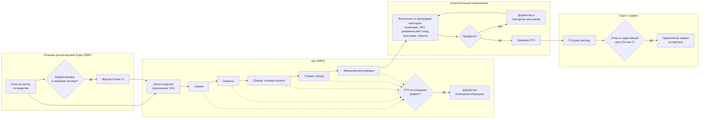

# 2. Производственный процесс

Модель процесса «как есть» (упрощённая BPMN-нотация: дорожки - подразделения, ромбы - решения). Именно эти шаги порождают события, которые попадают в данные.

## Где возникают потери (и что показал анализ)

| Шаг | Потеря | Метрика | Находка |
|---|---|---|---|
| Запуск | неравномерность графика | запуски в последние 3 раб. дня | «штурмовщина»: +40% запусков, ×1.42 дефектность |
| Операции | дефект, пойманный ОТК | доля операций-источников дефекта | ночная окраска №2 ЦЛА - вдвое выше нормы из-за текучести |
| Операции | дефект, пропущенный ОТК | доля дефектов, найденных на испытаниях | ~45% дефектов доходят до лаборатории |
| Испытания | дефект, пропущенный стендом | утечка после динамического стенда | старый стенд ИЛ-2 - ×4.9 к норме |
| Эксплуатация | гарантийный случай | накопленная доля по когортам | тяжёлая техника ~1.8% за год |
| Весь маршрут | простой узкого места | внеплановые простои, ч | окрасочная камера ЦГА, II-III.2026 - срыв плана |

## Точки сбора данных

| Событие | Система | Таблица |
|---|---|---|
| План / корректировка плана | ERP | файлы `plan_YYYY-MM_vN.csv` → `raw.erp_production_plan` |
| Запуск, операция, доработка, дефект на линии | MES | `plant.units`, `plant.operations`, `plant.defects` |
| Испытание и используемое оборудование | MES (модуль лаборатории) | `plant.tests`, `plant.test_equipment` |
| Простой участка | MES | `plant.section_downtimes` |
| Отгрузка | MES | `plant.shipments` |
| Гарантийная заявка | дилерский портал | файлы `claims_YYYY-Www.json` → `raw.dealer_warranty_claims` |
