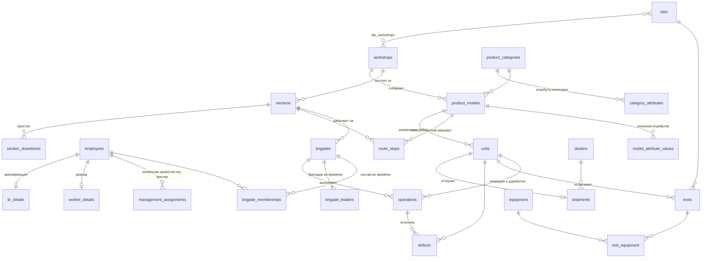
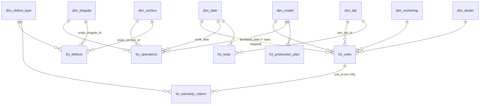

# 3. Модель данных

## 3.1. Что было не так в учебной схеме и как исправлено

| Проблема исходной схемы | Последствие | Решение |
|---|---|---|
| Две модели персонала одновременно: `Workers/Engineers/Foremen/Masters/Supervisors` и `People` | два источника правды, данные расходятся | одна таблица `employees` + таблицы атрибутов категорий `worker_details` / `itr_details` |
| DDL не совпадает с диаграммой и запросами (`stage_order`, `Works`, `ProductWorkCycle` отсутствуют) | код не запускается | схема пересобрана и проверяется автоматически (CI создаёт её с нуля) |
| `View_SectionsAndHeads` соединял начальников без условия на участок | декартово произведение | функция `report_sections_and_heads()` с условием по участку и дате |
| Атрибуты категорий (`capacity`, `performance`) лежали в `ProductCategories` | вместимость - свойство модели, а не категории | EAV `model_attribute_values`; принадлежность атрибута категории модели обеспечена **составными внешними ключами** |
| Нет разделения «модель» и «экземпляр» | нельзя посчитать брак и время сборки конкретной машины | `product_models` (вид изделия) и `units` (экземпляр с VIN) |
| Нет истории: состав бригад без дат, `DELETE` рабочего | после увольнения неизвестно, кто собирал машины | периоды `[valid_from, valid_to)` + **exclusion-ограничения** против пересечений; увольнение вместо удаления |
| Нет `NOT NULL`, `CHECK`, индексов; бригадир мог не состоять в бригаде | грязные данные | ограничения на всех таблицах, триггер «бригадир - член бригады», индексы под запросы и инкрементальную выгрузку |
| Испытания без результата | нечего анализировать | `tests.result`, повторные попытки, `defects` с точкой обнаружения и операцией-источником |

## 3.2. Операционная БД (MES), ключевые сущности

34 таблицы, 3НФ. Ниже - ядро (справочники типов опущены).



### Целостность без триггеров: составные внешние ключи

Правило «атрибут должен принадлежать категории модели» обычно реализуют триггером. Здесь оно выражено декларативно:

```sql
-- в product_models и category_attributes объявлены UNIQUE (model_id, category_id) и UNIQUE (attribute_id, category_id)
CREATE TABLE model_attribute_values (
    model_id, category_id, attribute_id, value_num, value_text,
    FOREIGN KEY (model_id, category_id)     REFERENCES product_models (model_id, category_id),
    FOREIGN KEY (attribute_id, category_id) REFERENCES category_attributes (attribute_id, category_id)
);
```

Тот же приём используется ещё в нескольких местах:
- бригадир - только рабочий, начальник участка - только ИТР: FK по `(employee_id, staff_category)`;
- шаг маршрута: участок из цеха модели и тип работ, совпадающий с типом участка;
- операция: бригада с того же участка, что и шаг маршрута;
- оборудование испытания - только из той лаборатории, где проводится испытание;
- лаборатория должна обслуживать цех изделия (`lab_workshops`).

### История и пересечения периодов

```sql
-- рабочий не может одновременно состоять в двух бригадах
EXCLUDE USING gist (employee_id WITH =, daterange(valid_from, valid_to) WITH &&)
-- у участка в каждый момент один начальник
EXCLUDE USING gist (section_id WITH =, daterange(valid_from, valid_to) WITH &&) WHERE (role_code = 'section_head')
```

## 3.3. Хранилище: звезда и витрины



| Таблица | Зерно | Тип | Особенности |
|---|---|---|---|
| `fct_operations` | операция (включая доработки) | транзакционный факт, **инкрементальный** | окно 3 дня + пересчёт «поздних» фактов (дефект найден позже на испытаниях); состав бригады на дату работ |
| `fct_tests` | попытка испытания | транзакционный, инкрементальный | использованное оборудование, признак списанного оборудования |
| `fct_defects` | дефект, найденный на заводе | транзакционный | прослеживание до операции-источника, стоимость доработки |
| `fct_units` | экземпляр изделия | **накопительный снапшот** | вехи (запуск, сборка, приёмка, отгрузка), FPY, затраты, гарантия, утечка после стенда |
| `fct_warranty_claims` | гарантийная заявка (итоговое состояние) | транзакционный | дедупликация событий портала, сопоставление по VIN |
| `fct_production_plan` | месяц × модель | периодический снапшот | последняя и первоначальная версии плана ERP |
| `dim_employee` | версия атрибутов сотрудника | **SCD2** | из dbt-снапшота |
| `mart_*` | агрегаты под дашборды | витрины | см. `dwh/models/marts/bi` |

Документация каждой модели с lineage-графом: `make docs`.
