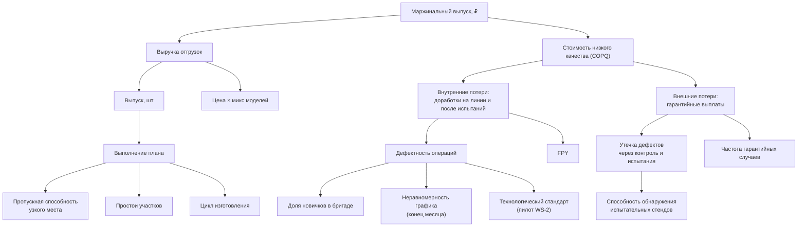

# 4. Метрики

## Дерево метрик

Целевая метрика уровня завода - **маржинальный выпуск**: сколько годной продукции произведено и продано, за вычетом потерь от низкого качества.

Листья дерева - **управляемые рычаги**: на каждый в проекте есть анализ и рекомендация.

## Глоссарий

| Метрика | Формула | Источник | Комментарий |
|---|---|---|---|
| Выпуск | число изделий, принятых ОТК после испытаний | `fct_units.accepted_date` | факт для план-факта |
| Выполнение плана | выпуск / план (последняя версия ERP) | `fct_production_plan` | на дашборде - скользящее за 3 месяца |
| FPY (First Pass Yield) | доля принятых изделий без дефектов на линии и без провалов испытаний с первой попытки | `fct_units.is_first_pass` | завод - 82.8% |
| Дефектность операций | операции - источники дефекта / все операции (без доработок) | `fct_operations.caused_defect` | включает дефекты, найденные позже на испытаниях (прослеживание по операции-источнику) |
| Доля дефектов, пропущенных линией | дефекты, найденные на испытаниях / все заводские дефекты | `fct_defects.detection_point` | ~44% |
| Доля новичков в бригаде | члены бригады со стажем < 90 дней / численность на дату работ | `int_brigade_daily` | порог - `cost_parameters.newcomer_tenure_days` |
| Цикл изготовления | приёмка ОТК - запуск, ч | `fct_units.total_lead_time_h` | медиана и P90 по модели |
| Простои | сумма длительностей, внеплановые отдельно | `fct_downtime` | |
| Стоимость доработки | нормо-часы доработки × 1 450 ₽ | `fct_defects.rework_cost_rub` | ставка - seed `cost_parameters` |
| COPQ | доработки + одобренные гарантийные выплаты | `mart_copq_monthly` | на изделие и в % выручки |
| Утечка после стенда | изделия, у которых дефект DYN-типа нашли позже (на обкатке или у дилера) / изделия, прошедшие стенд, × 1000 | `fct_units.leaked_after_dyn` | ранний индикатор надёжности оборудования |
| Накопленная доля гарантийных случаев | 1 − ∏(1 − hₖ), hₖ - доля случаев в k-м месяце среди изделий, наблюдаемых весь месяц | `mart_warranty_cohorts` | учитывает цензурирование; в анализе - Каплан-Мейер |
| Эффект WS-2 (DiD) | (дефектность пилота после / до) / (контроля после / до) − 1; основная оценка - logit с FE участка и месяца | `mart_welding_pilot`, `fct_operations` | ноутбук 03 |

## Почему не «простые» метрики

- **Гарантия.** «Доля машин с заявкой» несравнима между партиями разного возраста: свежие машины ещё не успели сломаться. Поэтому - когорты с фиксированным горизонтом.
- **Дефектность бригад.** Доли считаются как отношение сумм, а не среднее месячных долей (иначе месяц со 10 операциями весит столько же, сколько месяц с 300).
- **Эффект изменения.** «До/после» смешивает эффект с общим трендом; «пилот против контроля» - с исходной разницей участков. Корректная оценка - разность разностей.
