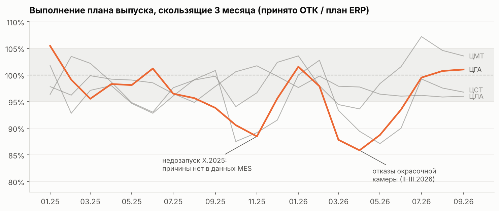
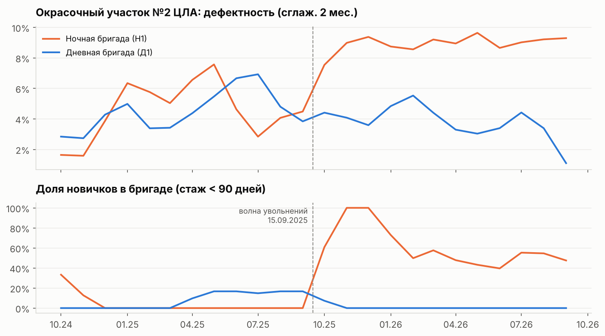
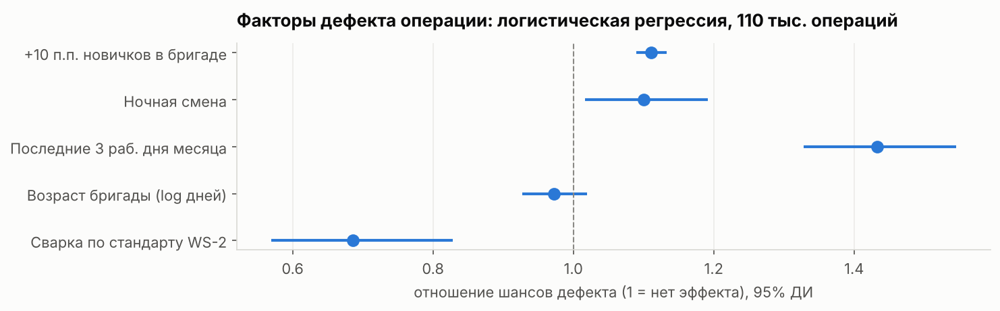
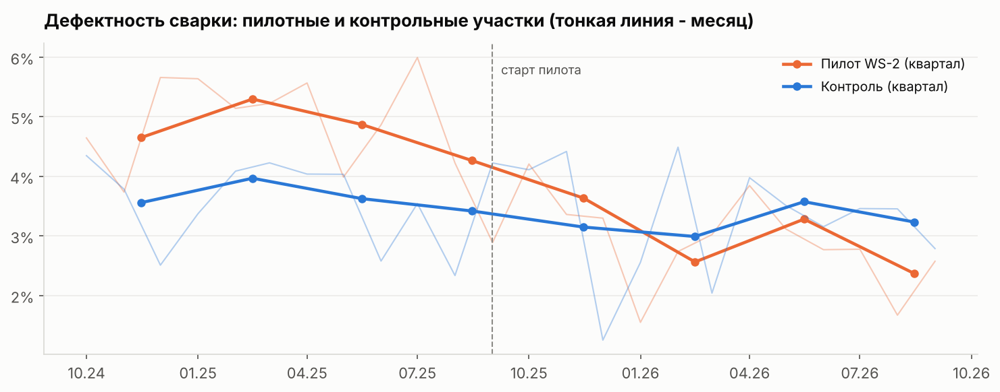
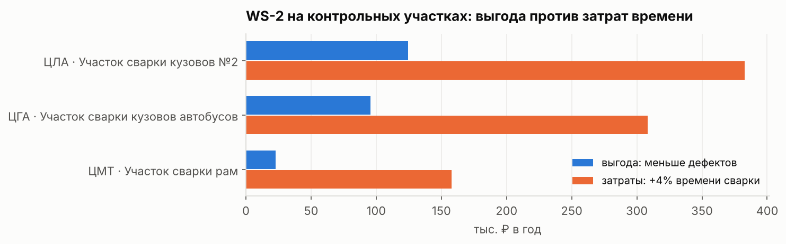
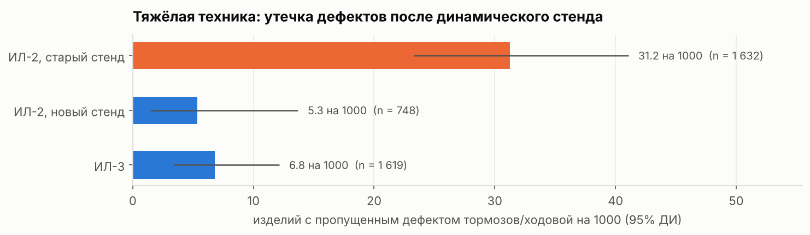
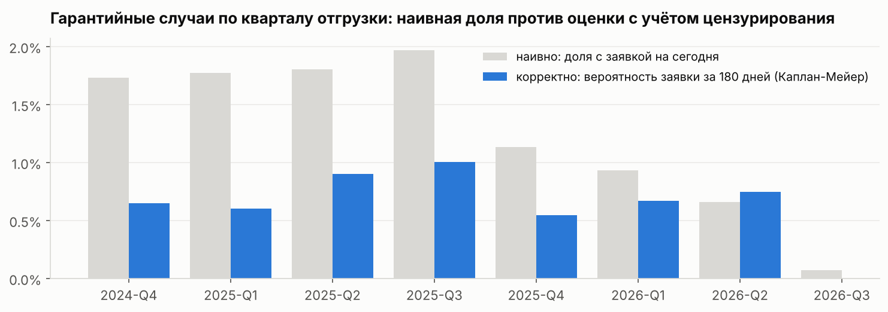

# Аналитическая записка: производство и качество, X.2024-IX.2026

**Кому:** директору по производству, главному технологу, начальнику ОТК
**Период:** 01.10.2024-30.09.2026 · 22.2 тыс. изделий · выручка отгрузок 77.5 млрд ₽

## Резюме

1. **Брак растёт там, где уходят люди.** Рост дефектов окраски в ЦЛА с осени 2025 - не оборудование и не материалы, а текучесть в одной ночной бригаде: дефектность выросла с 4.7% до 9.0%. Доля новичков в бригаде - фактор по всему заводу: +10 п.п. новичков дают +11% к шансам дефекта.
2. **Стандарт сварки WS-2 работает, но в нынешнем виде не окупается.** Дефектов сварки на трети меньше, но операция на 4% дольше, и это стоит дороже предотвращённых дефектов. Рекомендация - упростить стандарт, а не тиражировать как есть.
3. **Старый тормозной стенд пропускал дефекты.** До замены в марте 2026 изделия со стенда ИЛ-2 в 4.9 раза чаще возвращались с дефектами тормозов и ходовой; это стоило ~2.5 млн ₽ гарантийных выплат. Нужен регулярный мониторинг «утечки» по стендам.
4. **Конец месяца - зона риска.** В последние 3 рабочих дня запусков на 40% больше, а дефектность в 1.42 раза выше.
5. **Весенний срыв плана ЦГА** вызван отказами окрасочной камеры - единственного пути для всех машин цеха: −58 машин к плану, 0.76 млрд ₽ выручки сдвинуто на следующие месяцы.

## 1. Выпуск и план

| Цех | Принято, шт. | FPY | Медиана цикла, ч | Доработки, млн ₽ | Гарантия, млн ₽ |
|---|---|---|---|---|---|
| ЦЛА (легковые) | 13 045 | 83.3% | 26 | 3.29 | 5.68 |
| ЦМТ (мото) | 5 118 | 85.0% | 25 | 0.62 | 0.77 |
| ЦГА (грузовые, автобусы) | 2 919 | 78.5% | 81 | 2.71 | 4.99 |
| ЦСТ (спецтехника) | 1 076 | 78.6% | 120 | 1.13 | 4.65 |

ЦГА дважды проседал по плану. Весной 2026 (февраль-апрель, 86-87%) - из-за серии отказов окрасочной камеры: 141 час внеплановых простоев за два месяца при обычных 0-6 часах. Осенью 2025 цех запустил в октябре на 22% меньше машин, чем требовал план, при нормальной работе всех участков - причину в данных MES найти нельзя, вопрос передан в планово-диспетчерский отдел.

**Рекомендации:** план-график ППР и резерв критичных узлов окрасочной камеры ЦГА; на дашборде - сигнал при внеплановом простое узкого места дольше 8 часов.

## 2. Качество: причины брака

- В сентябре-октябре 2025 из ночной бригады окрасочного участка №2 ЦЛА ушли почти все опытные маляры. Новички уходят в среднем через 2 месяца - за год через бригаду из 6 человек прошли 26. Дефектность ночной смены удвоилась и держится; дневная смена на том же оборудовании - без изменений.
- Модель по 110 тыс. операций подтверждает механизм по всему заводу: доля новичков - самостоятельный фактор брака (как и ночная смена и конец месяца).
- Новая бригада выходит на 95% нормы времени примерно за 11 недель, а качество достигает уровня участка только к 9-му месяцу.

**Рекомендации:**
1. Ночная смена окраски №2: два наставника из дневной смены на 3 месяца, 100% контроль ЛКП до стабилизации.
2. HR: разбор причин ухода новичков (условия и оплата ночной смены) - без этого наставничество не решит проблему.
3. Правило комплектования: не более 30% новичков в бригаде на окраске и сварке; индикатор доли новичков - на дашборде мастера.
4. Новые бригады: закладывать в план 2.5 месяца освоения со сниженным тактом, включать в состав 1-2 опытных сотрудников.
5. Выравнивание суточного графика запусков вместо «догона» плана в конце месяца.

## 3. Пилот стандарта сварки WS-2

Оценка - разностью разностей (пилотные участки против контрольных, до и после 01.09.2025), с проверкой параллельности трендов и рандомизационным тестом.

| | Значение |
|---|---|
| Эффект на дефектность сварки | −36% к шансам дефекта (95% ДИ −14…−53%) |
| Эффект на время операции | +4.0% |
| Наивная оценка «до/после» (для сравнения) | −40%: завышена за счёт общего улучшения сварки |
| Выгода тиражирования на 3 контрольных участка | 0.24 млн ₽/год |
| Затраты дополнительного времени | 0.85 млн ₽/год |
| Безубыточность | доп. время ≤ 1.1%, **или** полная стоимость дефекта сварки ≥ 10.6 тыс. ₽ (учтённая - 3.0 тыс. ₽) |

**Рекомендация:** не тиражировать WS-2 в текущем виде. (1) Вместе с технологами разложить стандарт на элементы и сохранить те, что дают эффект без добавочного времени (режимы сварки), сократив сплошную зачистку и контроль. (2) Оценить неучтённые потери от сварочного дефекта: простой линии при возврате изделия с испытаний, задержку отгрузки, риск лома - если полная стоимость выше 10.6 тыс. ₽, решение меняется.

## 4. Гарантия и испытательное оборудование

- Изделия, проверенные на тормозном стенде ИЛ-2 1998 года, пропускали дефекты тормозов и ходовой в 4.9 раза чаще (31 против 5-7 на 1000 изделий). После замены стенда в марте 2026 утечка вернулась к норме. Избыточные гарантийные выплаты - около 2.5 млн ₽, без учёта ущерба отношениям с дилерами коммерческой техники.
- Гарантийную частоту нельзя мерить «долей машин с заявкой»: у свежих партий она искусственно низкая (машины ещё не успели сломаться). Корректная оценка - когорты с фиксированным горизонтом и кривые Каплана-Мейера: за первый год эксплуатации гарантийный случай у 1.8% тяжёлой техники и 1.0-1.3% легковых и мото.

**Рекомендации:** ежемесячный мониторинг «утечки» по каждому стенду (метрика есть в хранилище и на дашборде) - она сигнализирует о проблеме за 2-3 месяца, задолго до накопления гарантийной статистики; при аттестации стендов проверять способность обнаружения на эталонных изделиях с заведомыми дефектами.

## 5. Стоимость низкого качества

За два года: **доработки 7.8 млн ₽, гарантия 16.1 млн ₽** (одобренные выплаты). Две трети потерь - внешние: дефект, пропущенный заводом, обходится в разы дороже пойманного. Поэтому самые выгодные рычаги - те, что повышают обнаружение на заводе (стенды, ОТК на рискованных сменах), а не только снижают возникновение дефектов.

## Следующие шаги

| Действие | Ответственный | Срок | Как проверим эффект |
|---|---|---|---|
| Наставничество и контроль в ночной окраске №2 | начальник ЦЛА | 1 месяц | дефектность бригады < 5% через 3 месяца |
| Разбор причин увольнений новичков | HR | 1 месяц | медиана стажа новичков > 6 мес. |
| Упрощённая версия WS-2 + полная стоимость дефекта | главный технолог | 2 месяца | повторный пилот с рандомизацией по сменам |
| Мониторинг утечки по стендам | руководитель лабораторий | на дашборде | сигнал при превышении нормы в 2 раза |
| ППР и резерв окрасочной камеры ЦГА | главный механик | 1 квартал | внеплановые простои < 10 ч/мес. |
| Выравнивание графика запусков | ПДО | 1 квартал | доля запусков в последние 3 дня ≤ 15% |

*Методика и код: ноутбуки `notebooks/01-04`, витрины `dwh/models/marts`. Данные синтетические, параметры генератора и сопоставление с найденными эффектами - `docs/06_synthetic_data.md`.*
